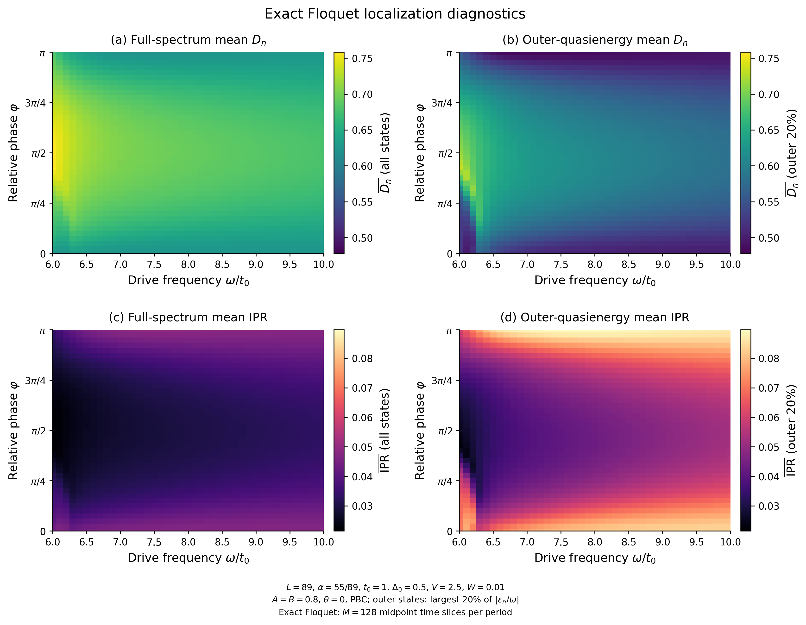

# Exact Floquet 二维热图

一维双组分准周期 Raman 晶格的真实时间有序 Floquet 数值结果。
主图参数：L=89，alpha=55/89，41×41 网格，每周期128个中点时间片。

## 下载到手机

- [下载热图压缩包（约2.5 MB）](https://github.com/unique-159753/god/raw/refs/heads/main/results/download/heatmaps.zip)
- [打开压缩包文件页面](results/download/heatmaps.zip)
- [直接查看四张主热图 PNG](results/download/exact_summary.png)
- [打开四张主热图 PDF](results/download/exact_summary.pdf)

压缩包内有30个 PNG/PDF 文件，包括四项 exact Floquet 热图、对应有效模型和差值热图、四图汇总、外侧态对比图与五条相位截线。

如果直接下载链接没有触发保存，请进入文件页面，使用 GitHub 的原始文件下载功能。私有仓库需要先登录有访问权限的 GitHub 账号。

## 主图预览

上排：全谱与外侧准能量态的平均 D_n，数值越大表示态分布越扩展。
下排：对应平均 IPR，数值越小表示态分布越扩展。

## 计算约定

- t0=1，Delta0=0.5，V=2.5，W=0.01，A=B=0.8，theta=0，PBC。
- 横轴 omega/t0 从6到10；纵轴 phi 从0到pi。
- Delta(tau)=Delta0+B*cos(omega*tau+phi)，因此 phi=pi/2 对应 Delta0-B*sin(omega*tau)。
- IPR 在原始自旋分辨基底计算，D_n=-ln(IPR_n)/ln(2L)。
- 每个参数点按绝对主值准能量重新选择外侧最高20%（向上取整，即36态）。
- 这里展示有限尺寸局域化诊断，未将窄结构直接认定为热力学相界。

校验和见 [SHA256SUMS.txt](results/download/SHA256SUMS.txt)。
