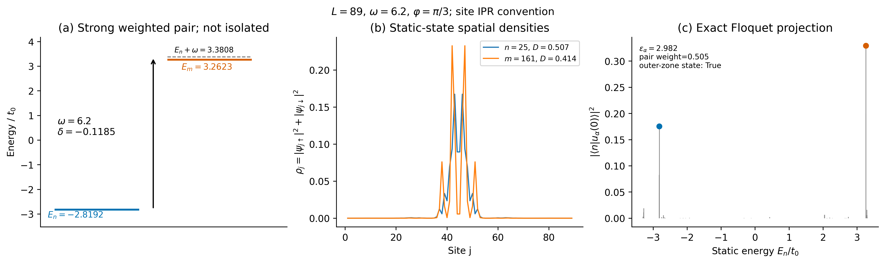
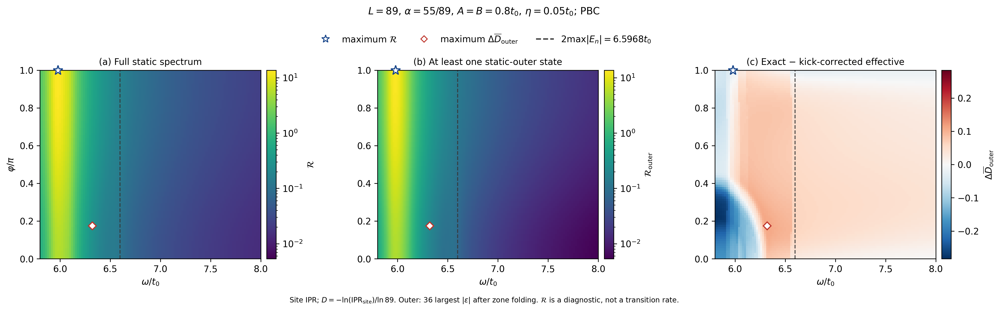
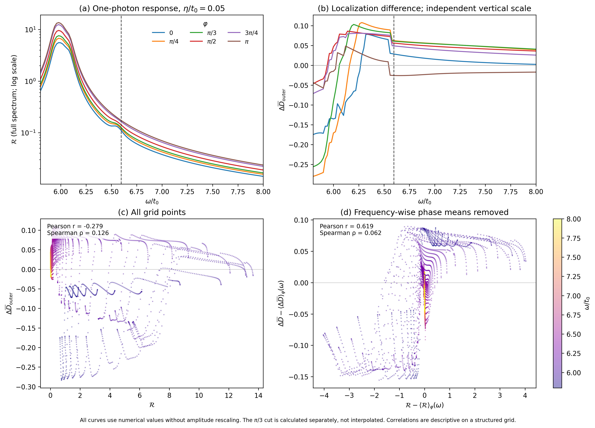
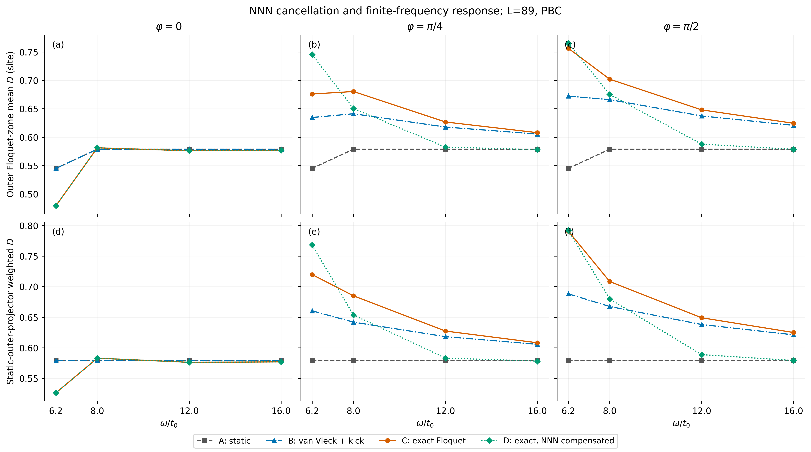
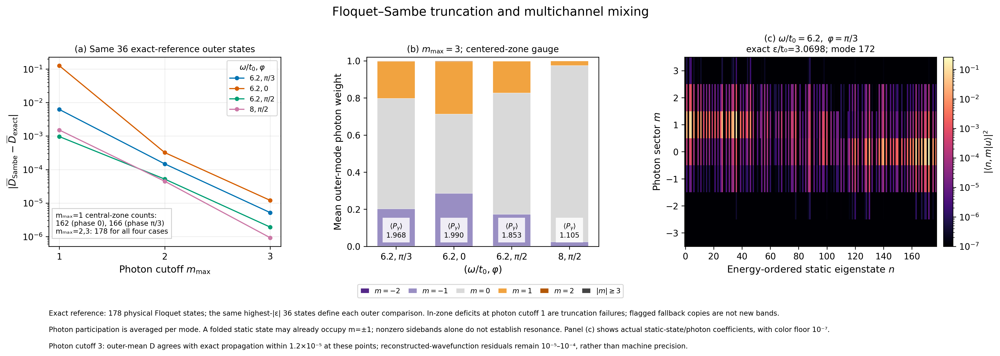

# 双驱动准周期 Raman 晶格：真实 Floquet 计算与机制检验

本报告对应最新粘贴的 Raman 晶格任务，采用用户确认的站点 IPR、折叠后外侧 36 态及两套对照定义。没有读取图片像素、构造示意数值或调用图像生成模型。此前 SVQL 双链模型的结果没有作为本模型数据使用。

**主要结论：** ω≈6.2 存在能够强混合较局域静态态的一光子通道；但裸一光子响应的峰值、相位规律与 exact/effective 的空间局域化差值并不相同。抵消一阶 NNN-SOC 后，低频增强仍然存在。Sambe 结果支持多态、多扇区混合，尚不能证明新共振机制、新能带或热力学相变。

## 1. 模型、观测量和计算范围

参数为 L=89、α=55/89、t₀=1、Δ₀=0.5、V=2.5、W=0.01、A=B=0.8、θ=0、周期边界，178 维单粒子空间。位置从 j=1 开始，基底为 (1↑,1↓,…,89↑,89↓)。计算的是驱动起点 τ=0 的 stroboscopic Floquet 本征态。

令 P[j,(j+1) mod L]=1，采用

```
T   = −(P+P†) ⊗ σz
S   =  (P−P†) ⊗ iσy
J₂ˣ = i(P²−P†²) ⊗ σx
H₀  = t₀T + Δ₀S + HZ
```

主观测量为

```
ρj = |ψj↑|² + |ψj↓|²
IPRsite = Σj ρj²
Dsite = −ln(IPRsite)/ln89.
```

同时保存 IPRcomponent=Σj,s|ψjs|⁴、Dcomponent=−ln(IPRcomponent)/ln178，以及用 ln89 归一化的分量版本。D 越大表示该有限系统中的态占据更多站点；它是有限尺寸参与指数。本次没有做尺寸标度，因此不能据此确认热力学分形相。

所有模型均先把能量折叠到 [−ω/2,ω/2)，再取 |ε| 最大的 36 态（ceil(0.2×178)），计算逐态 D 的算术平均。这里平均 D 并不等于对平均 IPR 再取负对数。共振诊断的静态外侧掩码另取未折叠 |E| 最大的 36 态，态对至少一个端点属于该集合。

主扫描使用 ω/t₀=5.8…8.0 的 111 点、φ=0…π 的 81 点，共 8991 点。φ=π/3 不在该网格上，因此额外计算了完整的 111 个 exact 点；没有插值替代。每点保留全部 178 个 exact/effective 模态的准能量、两种 IPR/D、外侧掩码、匹配及静态投影权重。

exact 指数值计算时间有序单周期传播子，不表示没有离散误差。主网格每周期 M=64，采用四阶时间推进和完整复 Schur 分解；四模型代表点及 Sambe 对照使用 M=128。独立 DOP853 积分、FFT 空间分解与原生 bond-rotation 后端用于交叉验证。

## 2. Fourier、有效项和 kick 的符号

使用 H(τ)=ΣℓHℓexp(+iℓωτ)，故吸收 Em−En≈+ω 的矩阵元取 H₋₁：

```
H±₁ = [AT + B exp(±iφ)S]/2
Mmn = ⟨m|H₋₁|n⟩
[T,S] = 2iJ₂ˣ
Heff = H₀ + [H₊₁,H₋₁]/ω = H₀ + (AB sinφ/ω)J₂ˣ.
```

有效本征态用 exp[−iK₁(0)] 还原到实验室参考系，其中 K₁(0)=B sinφ S/ω。补偿模型是在完整 H(τ) 中加入 −gFJ₂ˣ；它抵消首阶静态有效项，但不会同时消去 kick 和高阶修正。Fourier 对易子、kick 指数、Hamiltonian Hermiticity 和高频符号均已独立检验。

## 3. 问题一：ω≈6.2 是否存在一光子共振？

**存在有能力强混合的一光子近共振通道，但不是单个孤立的窄二能级共振。** 静态谱边缘为 ±3.2984041283，带宽与折叠参考频率为 6.5968082565。

在 (ω,φ)=(6.2,π/3)，按 |M|²/(δ²+0.05²) 排序的一组重要态对为静态能量排序下的 n=25、m=161（索引从 0 开始）：

| 量 | 实际计算值 |
|---|---:|
| En | −2.8191982316 |
| Em | +3.2622692854 |
| Em−En | 6.0814675170 |
| δ=Em−En−ω | −0.1185324830 |
| |Tmn|² | 0.866742 |
| |Smn|² | 0.020305 |
| |Mmn|² | 0.120702 |
| |Mmn| | 约 0.3474 |

耦合强度超过失谐，因而不能仅因 |δ|>0.1 就排除强混合。0.1 或 η 是人为诊断窗口，并非物理共振的绝对边界。反过来，最小失谐约 0.08036 的态对未必有最强耦合。

上述最强一对仅占正能级差共振诊断的 4.40%，前十对合计 43.20%。|δ|≤0.1 内有 66 个非零耦合态对，但仅占约 0.652% 的总权重。数据支持多通道混合，不能用一对态解释全部外侧谱。每个代表参数的前十对及近失谐列表、密度和矩阵元均已导出。

主展宽 η=0.05 时，全谱 R 的全局峰为 (ω,φ)=(5.98,π)，R=13.637631；静态外侧 R 峰也在这里，Rout=13.078582。η=0.02、0.10 时峰的位置相同。因此“存在 6.2 附近的一光子通道”不等于“诊断峰恰好位于 6.2”。



## 4. 问题二：共振响应与局域化异常热图是否吻合？

**两者有部分共同响应，但不呈逐点或峰值的一一对应。** 差值定义为 exact 外侧平均 D 减去 kick-corrected 一阶有效模型的外侧平均 D。

| 全网格极值 | ω/t₀ | φ/π | 数值 |
|---|---:|---:|---:|
| Rfull 最大，η=0.05 | 5.98 | 1 | 13.637631 |
| Router 最大，η=0.05 | 5.98 | 1 | 13.078582 |
| ΔDouter 最大 | 6.32 | 0.175 | +0.109718 |
| ΔDouter 最小 | 5.8 | 0.225 | −0.283503 |

这是有限网格的极值位置，精度受 Δω=0.02、Δφ=π/80 限制，不是连续参数空间极值的精密拟合。差值全局最大相位约 0.55 rad，实际不在原先假设的 π/4…π/2 区间；但固定 ω=6.2 时，其相位峰在 0.325π，ΔD=0.103325，而 R 峰仍在 π。

Pearson 对数值幅度和高方差区域敏感；Spearman 衡量秩的单调对应。两者差异很大，因此不能挑选较高的一个来宣布热图吻合。

| Rfull 与 ΔDouter 的相关性，η=0.05 | Pearson | Spearman |
|---|---:|---:|
| 全网格原始值 | −0.2788 | +0.1260 |
| 全网格，分别扣除逐频率相位均值 | +0.6190 | +0.0622 |
| 仅 ω=6.0…6.6，原始值 | −0.3283 | −0.3533 |
| 仅 ω=6.0…6.6，扣除逐频率相位均值 | +0.6537 | +0.3533 |

去均值后存在幅度加权的正协变，但全窗口的秩对应仍弱。散点图显示不同频率、相位产生多支结构，不能以单一线性关系概括。这里是结构化网格的描述统计，没有把各网格点当成独立实验样本计算显著性。

展宽敏感性也已保留：η=0.02、0.05、0.10 的原始 Pearson 分别为 −0.2381、−0.2788、−0.3030；去均值 Pearson 为 +0.5427、+0.6190、+0.6673，而去均值 Spearman 为 +0.0850、+0.0622、+0.0630。定性判断不依赖单个 η。

R 是带展宽的诊断量，不是吸收率或跃迁概率。Rnorm=η²R，在固定 η 下只是整体乘正数，其相关系数完全相同；本参数模型中 0≤Rnorm≤0.64（单位随能量单位），不应叫作概率归一化。





## 5. 问题三：矩阵元相位干涉能否解释异常相位偏移？

**仅靠裸一光子矩阵元的相位强度不足以解释。** 由于 H₀、T、S 在所选基底中为实矩阵，可以取实静态本征矢，严格得到

```
|Mmn(φ)|² = [A²Tmn² + B²Smn² + 2AB TmnSmn cosφ]/4
R(ω,φ) = a(ω) + b(ω)cosφ.
```

直接矩阵元和解析分解的最大差为 2.78×10⁻¹⁶。固定频率下，相位峰只能在 0 或 π，或者曲线完全平坦；b(ω) 可变号，但不可能因此出现严格内部峰。ω=6.2 时 R 随 0→π 增大，ΔD 却在约 0.325π 达峰。

这与 gF∝sinφ 是不同的物理量。结果并未排除一光子通道参与完整演化，而是排除“把 R 或单个 cosφ 强度直接当成 ΔD 的完整解释”。完整态结构、多通道 dressing、微运动及准能选态也会影响空间参与程度。

## 6. 问题四：哪些态参与混合，原先是否局域？

上述 n=25、m=161 的站点 D 分别约 0.5071、0.4136，对应参与站点数 1/IPR 约 9.74、6.40；原先主要集中在 j≈44…49 的同一局域区域，并不是两个遥远中心的简单共振桥。

在 (6.2,π/3)，与该态对有较大投影的外侧 Floquet 态 ε=2.982116871、Dsite=0.6316268。投影到 m=161、n=25 的总权重只有 0.50471；还包含静态态 157、21、159、23 等，静态基底参与数约 5.21。因此 Figure 3 明确标注其为强权重态对，而不是孤立二态模型。

相位改变后参与的物理态也改变：φ=0 时，最强态对投影较大的 Floquet 态不属于所定义的外侧 36 态；最佳外侧态对投影仅约 0.0715。不能把 φ=π/3 的代表态对跨相位强行当成同一外侧支。

空间与自旋的区分会改变解释。例如 ω=6.2、φ=0，相对静态模型的站点 D 变化为 −0.065824，说明该外侧平均在空间上更局域；分量 D 的变化却为 +0.036467。分量结果的一部分可以来自自旋重分布，不能单独称为空间退局域化。

### 折叠选态和分支控制

静态波函数未变时，折叠后的外侧集合仍会随 ω 改变。2max|E|=6.596808 恰好位于研究窗口内，因此不能把参考线附近的硬外侧均值变化全部理解为同一组态的空间展开。

用实验室参考系波函数平方重叠做 Hungarian 一一匹配，得到严格的代数分解：

```
ΔDhard = ΔDmatched + ΔDselection.
```

在差值峰 (6.32,0.175π)，三者分别为 +0.109718、+0.079601、+0.030117。选态效应不可忽略，但又不能解释全部差值。固定静态外侧子空间、按投影权重连续加权的另一个诊断给 +0.098246，仍保留明显差异。

ω=6.2、φ=π/3 时，硬差为 +0.103084，匹配项 +0.084468，选态项 +0.018616；静态投影差为 +0.108925。但平均逐态匹配重叠仅约 0.527，这种匹配不是唯一可信的连续物理分支标签。低重叠、近简并及重排均保留在原始数据中；这些分解是稳健性对照，不是因果份额。

## 7. 问题五：NNN-SOC 与有限频率过程分别解释多少？

四模型采用同一折叠、外侧规则和实验室参考系：A=H₀，B=一阶 Heff 加 kick，C=exact，Dcomp=exact 加 −gFJ₂ˣ。下表是 M=128 代表点的站点外侧平均 D。

| ω/t₀ | φ/π | A 静态 | B 一阶+kick | C exact | Dcomp 补偿 |
|---:|---:|---:|---:|---:|---:|
| 6.2 | 0 | 0.545238 | 0.545238 | 0.479414 | 0.479414 |
| 6.2 | 0.25 | 0.545238 | 0.634802 | 0.676126 | 0.745411 |
| 6.2 | 0.5 | 0.545238 | 0.672384 | 0.756541 | 0.765376 |
| 8 | 0 | 0.579001 | 0.579001 | 0.581406 | 0.581406 |
| 8 | 0.25 | 0.579001 | 0.641349 | 0.680484 | 0.650416 |
| 8 | 0.5 | 0.579001 | 0.666171 | 0.702149 | 0.675356 |
| 12 | 0 | 0.579001 | 0.579001 | 0.576229 | 0.576229 |
| 12 | 0.25 | 0.579001 | 0.617977 | 0.626869 | 0.582724 |
| 12 | 0.5 | 0.579001 | 0.637524 | 0.648164 | 0.587901 |
| 16 | 0 | 0.579001 | 0.579001 | 0.577059 | 0.577059 |
| 16 | 0.25 | 0.579001 | 0.605580 | 0.608059 | 0.578132 |
| 16 | 0.5 | 0.579001 | 0.620935 | 0.624600 | 0.578808 |

在 ω=6.2、φ=π/2，C−A=+0.211302，一阶模型 B−A=+0.127146，未被 B 描述的差值 C−B=+0.084156；抵消首阶项后 Dcomp−A=+0.220137，增强没有消失。在 φ=π/4，补偿甚至使平均 D 从 0.676126 增至 0.745411。这排除显式一阶 NNN 项是低频增强唯一或必要来源的断言。

到 ω=16、φ=π/2，C−A=+0.045599、C−B=+0.003666、Dcomp−A=−0.000193。一阶+kick 在该高频代表点较好地重现平均变化，补偿也回到静态附近。只计算了有限几个频率，不据此拟合严格渐近幂律。

补偿残差不能全部命名为共振。额外计算 A_kick=exp(−iK₁) 作用于静态态的基线：ω=6.2、φ=π/2 时，A_kick−A 仅 +0.006504，而 Dcomp−A_kick 仍为 +0.213633；首阶 kick 单独不能解释大残差。ω=16 时，两项为 +0.000973 和 −0.001167，部分抵消才使补偿结果接近裸静态。

另外，实静态非简并态的一阶波函数修正由纯虚 J₂ˣ 产生，概率的线性变分通常为零；首阶 kick 也有这一性质。平滑 IPR/D 修正一般从 O(ω⁻²) 起，而被截断的二阶有效项和二阶微运动同阶影响这一观测量。因此 B−A 不能叫作完整、独立的一阶观测量贡献，更不能把差值比作为可相加的因果百分比。

ω=8 已超过静态总带宽，裸静态能级差不可能满足 Em−En=ω，最小失谐约 1.40319，但 exact/effective 仍有差异。这说明不能把所有有限频率残差都归于裸一光子 on-shell 共振。



### Sambe 扇区分析

构造 HFmn=H(m−n)+mωδmn，使用光子截断 mmax=1、2、3；根据中心准能区、准能量和重构相位零波函数重叠，与 exact 的 178 个物理态一一匹配，显式记录回填副本和光子规范。

mmax=1 在 (6.2,0)、(6.2,π/3) 的中心区候选只有 162、166 个，且 φ=0 的外侧均值误差可达 0.125893，三扇区截断不足。mmax=2、3 在四个代表点均得到完整 178 个中心区态；mmax=3 的外侧平均 D 与 exact128 相差不超过 1.2×10⁻⁵，准能量误差不超过约 1.5×10⁻⁶。重构波函数的传播子残差仍在 10⁻⁵…10⁻⁴，不能称机器精度的波函数收敛。

(6.2,π/3)、(6.2,0)、(6.2,π/2)、(8,π/2) 的外侧平均光子参与数约为 1.968、1.990、1.853、1.105，前者确有较强多扇区 dressing。但 φ=0 也有强混合而空间 D 下降；“光子混合强”不自动等于“更退局域”。6.2 的两个最大静态-光子分量平均只占约 0.38…0.52，其余通道不可忽略。

全扫描 2ω≥11.6，大于裸静态带宽 6.596808，所以两裸静态态不能满足 Em−En=2ω。±2 扇区权重可来自连续的一光子虚过程和 dressing，**不能当成真实裸两光子共振证据**。光子权重还依赖准能规范；零驱动时折叠态也可能主要落在 ±1 扇区。这里没有把重复副本计作新能带，也没有绘制未经扫描验证的避免交叉轨迹。



## 8. 问题六：是否证明超出常规 Floquet 共振或单驱动的新现象？

**目前没有。** 已证实双驱动相位可改变空间局域响应、低频存在首阶有效理论不能完整描述的变化，也存在多态、多光子扇区 dressing。但这些与常规 Floquet 一光子混合、虚过程、高阶修正、微运动及准能分支重组相容。

额外完成 18 个单驱动控制参数组合，使用 M=128：A-only 为 A=0.8、B=0，B-only 为 A=0、B=0.8；ω=6.2、8、16，φ=0、π/4、π/2。A-only 的 Hamiltonian 无 φ，因此三个标签复用同一传播子，并在元数据中说明。两种控制均保留静态 t₀、Δ₀ 和 HZ；它们不是无驱动模型，而且 gF 都为零。

ω=6.2 时，A-only 的外侧 D 为 0.612728；B-only 在上述三相位分别为 0.681116、0.671665、0.647855，均高于静态 0.545238。双驱同相反而为 0.479414，比两种单驱都更局域；双驱 φ=π/2 则为 0.756541，高于两种单驱。这直接否定“gF=0 就没有局域化响应”及“任意双驱都比单驱更退局域”的说法。

到 ω=16，两种单驱的 D−Dstatic 约为 −0.00313 和 +0.00025…+0.00096，而双驱 φ=π/4、π/2 分别为 +0.02906、+0.04560，双驱效应更突出。但单驱和双驱的总振幅预算不同，这些点比较不是非线性协同机制的严格因果分解。

B-only 的 φ 只是改变单一驱动的时间原点：准能谱差不超过 1.42×10⁻¹⁴，而 τ=0 观测的 IPR 可以随微运动相位变化。这种单驱相位变化本身不能命名为双驱相对相位干涉。全部单驱模态、kick 基线和双驱参照列见 `single_drive_controls.csv/.npz`。

本次没有做热力学尺寸标度、完整振幅扫描、长期波包输运或系统性文献优先权调查。因此不能据此声称新相变、独立的新共振类型，或已证明与所有既有单驱动结果本质不同。

## 9. 数值可靠性及实际误差

`grid_validation.json` 对全部 8991 个网格点和 111 个额外切线点检查通过：坐标唯一、每点 178 模态、折叠范围、外侧 36 态、两套 IPR/D 的关系、静态投影权重和为 36、匹配排列及差值分解恒等式、CSV 行数和模型源 SHA256 一致。主网格最大相对幺正残差约 2.95×10⁻¹⁴，最大本征方程残差约 9.75×10⁻¹⁵。这些残差检验的是已计算传播子的性质，不能单独用来界定近简并态的 IPR 误差。

选择真实的差值最大/最小点、最小谱隙、最小外侧选态间隙和代表物理参数，共 9 点，执行 M=32、64、128 及独立 DOP853（rtol=2×10⁻¹²、atol=2×10⁻¹⁴）对照。除敏感点外，M64 的外侧平均 D 对 ODE 的绝对误差约 1.27×10⁻⁷…5.52×10⁻⁷；差值最大点的误差为 4.51×10⁻⁷。代表 (6.2,π/3) 的 M32/64/128 误差约 7.44×10⁻⁶、4.64×10⁻⁷、2.90×10⁻⁸，符合四阶收敛。

敏感点 (ω,φ)=(6.2,π/40) 的误差较大，因此继续加密，并明确保留主网格 M64 原值及单独的高精度参照：

| 每周期时间步 M | 外侧平均 D 对独立 ODE 的绝对误差 |
|---:|---:|
| 64 | 4.7663×10⁻⁴ |
| 128 | 2.8808×10⁻⁵ |
| 256 | 1.7960×10⁻⁶ |
| 512 | 1.1045×10⁻⁷ |

该点 ODE 外侧 D≈0.4826690746，M512≈0.4826689642；重叠匹配后没有外侧成员交换，主要是近邻本征模态对时间离散的敏感旋转。主网格及主相关系数仍按统一 M64 定义，没有悄悄替换个别值。这是抽样收敛验证，不是全部 9102 点的统一误差上界。

最小本征相位间隙约 6.24×10⁻¹³，位于 (6.14,π/80)；共有 51 个主网格点的最小间隙低于 10⁻⁹。另用反射×σz 对称算符 Q 分块、子空间重叠及 ODE 检查该最小隙点，外侧平均 D 对近简并基底选择仍有约 1.2×10⁻⁵ 的敏感性。因此没有把每个单态 IPR 都宣称为机器精度稳定。所有被抽查点均未出现重叠匹配后的硬外侧成员交换；跨模型低重叠的问题另行保留。

φ→−φ 的传播子转置关系和外侧平均 D 在代表点误差不超过约 3.1×10⁻¹⁴；解析矩阵元的相位偶性、Fourier 符号和粒子空穴配对也通过。补偿模型用独立 FFT 路径及 ODE 检查。单驱 18 组合的最大幺正残差约 1.14×10⁻¹³、本征方程残差约 1.76×10⁻¹⁴；(6.2,π/2) 的单驱 M128→256 均值差分别约 1.00×10⁻⁸、1.56×10⁻⁷。

验证完整模态与对照表见 `validation_diagnostics.npz/.csv`、`grid_sensitive_point_validation.json`、`grid_min_gap_Q_diagnostic.npz`、`solver_validation.json` 及 `sambe_validation.json`。

## 10. 文件与图注

主图均为真实数值 Matplotlib 图，PNG ≥300 DPI，并同时提供矢量 PDF。Figure 1 的 R 采用对数颜色，ΔD 使用有正负的线性颜色；两种量没有通过人为幅度缩放来匹配。Figure 2 六条相位切线使用各自独立纵轴和原始数值。Figure 3 的能级标注和密度来自实际本征态；Figure 4 比较四模型并增加静态投影诊断；Figure 5 展示截断检验和规范对齐的静态-光子权重。

完整数值主要见 `localization_grid.npz/.csv`、`localization_slices.npz`、`localization_extra_pi_over_3.csv`、`resonance_grid.npz/.csv`、`resonance_state_pairs.csv/.npz`、`representative_floquet_projections.npz`、`four_model_outer_comparison.csv/.npz`、`sambe_point*_M*.npz`。逐点缓存也完整保留。详细数据字典、复现命令、代码和源文件校验值一并交付。
