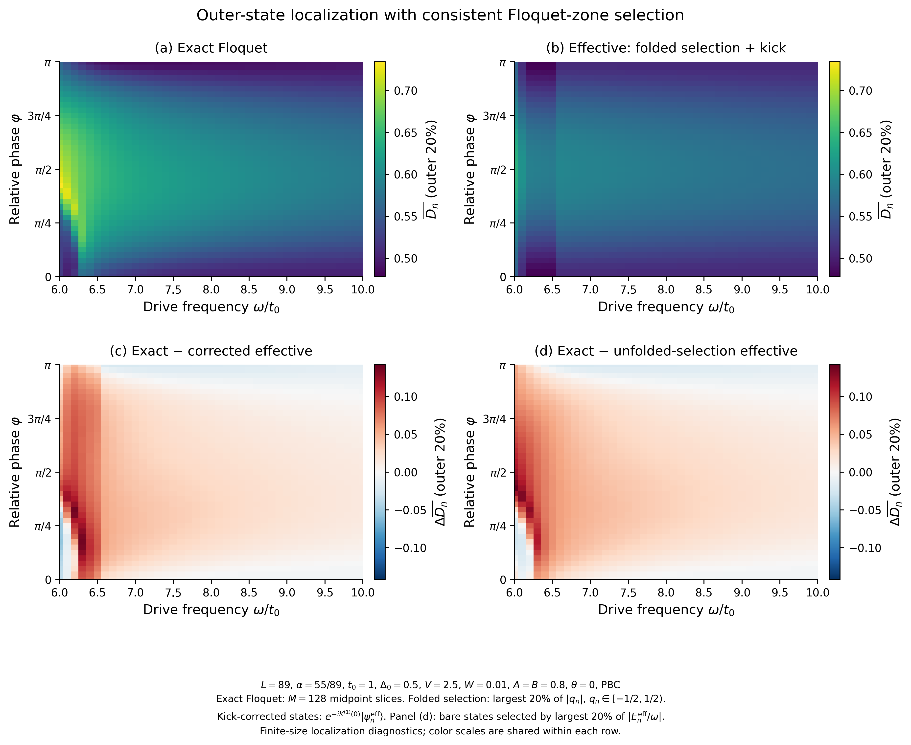

# Floquet folding, micromotion and state-selective delocalization

Actual NumPy/SciPy calculations for the driven quasiperiodic Raman chain, with publication figures from Matplotlib. Parameters: `L=89`, `alpha=55/89`, `t0=1`, `Delta0=0.5`, `V=2.5`, `W=0.01`, `A=B=0.8`, `theta=0`, PBC. The spin-resolved basis is `(1 up, 1 down, ..., L down)`.

## Download and read

- [Figures and report ZIP](https://raw.githubusercontent.com/unique-159753/god/main/results/folding_study/figures_and_report.zip): five PNG/PDF pairs, reports and key numerical tables.
- [Full study ZIP](https://raw.githubusercontent.com/unique-159753/god/main/results/folding_study/full_study.zip): all source code, CSV/NPZ data, validation, figures and the validated input cache.
- [中文结果分析](REPORT.md) · [English methods](METHODS.md) · [Download checksums](DOWNLOAD_SHA256SUMS.txt)

The principal findings are that consistent folding does not remove the low-frequency discrepancy, first-order kick dressing modestly reduces the aggregate error, and the outer states show a stronger phase response than the central states at frequencies 7–10. These finite-size data do not establish a new mobility edge or thermodynamic transition. See the report for numerical evidence and limits.

| Figure | Content | Files |
|---|---|---|
| 1 | Static energies, folded effective spectrum and exact Floquet spectrum | [PNG](fig1_quasienergy_folding.png) / [PDF](fig1_quasienergy_folding.pdf) |
| 2 | Exact, folded + kick, and two comparison error maps | [PNG](fig2_corrected_Douter_comparison.png) / [PDF](fig2_corrected_Douter_comparison.pdf) |
| 3 | Tracked state energies, localization and neighboring overlaps | [PNG](fig3_eigenstate_branch_tracking.png) / [PDF](fig3_eigenstate_branch_tracking.pdf) |
| 4 | Frequency-dependent errors under three effective conventions | [PNG](fig4_effective_model_errors.png) / [PDF](fig4_effective_model_errors.pdf) |
| S1 | Outer/central responses, fixed-q bins, same-kick g=0 control and mixing | [PNG](figS1_selectivity_controls.png) / [PDF](figS1_selectivity_controls.pdf) |



PNG files have 350 DPI. PDFs retain vector points, lines and color cells. No interpolation creates additional physical data. All means use the largest 20% of absolute normalized quasienergies, rounded up to 36 of 178 states, independently at every parameter point and in every model.

## Provenance

The 21 x 21 grid with 64 midpoint slices is newly evolved. The final 41 x 41 exact grid reuses the previous actual 128-slice calculation for this identical Hamiltonian. Three independently recomputed points match all quasienergies and IPRs; `provenance.json` records its SHA256. The input is included as `input_exact_grid128.npz`, so no previous workspace is needed. This is not a claim that the complete 41 x 41 exact grid was evolved again.

All effective comparisons, the three 401-point exact frequency scans (128 slices), and 153 additional local-refinement calculations are new. `--fresh-exact-grid` requests an independent complete re-evolution of the final grid. The exact solver uses an exact reflection-spin symmetry decomposition; it does not replace the driven evolution with a high-frequency Hamiltonian.

## Reproduce

Use Python 3.12 and the versions in [requirements.txt](requirements.txt). Extract the **full** archive, change into `folding_study`, and install the requirements in your chosen environment. Commands overwrite the corresponding generated outputs in that directory.

```bash
python -m pip install -r requirements.txt
export OPENBLAS_NUM_THREADS=1
export OMP_NUM_THREADS=1
export MPLCONFIGDIR=/tmp/floquet-folding-matplotlib
python theory_checks.py
python run_study.py
python validation.py
python refine_tracking.py
python quantify_results.py
python plot_figures.py
python plot_selectivity.py
python audit_study.py
```

Replace `python run_study.py` with `python run_study.py --fresh-exact-grid` to recompute the entire final exact grid. The default already recomputes the initial grid, all frequency curves and all effective comparisons. A fresh run changes measured timings and provenance; the supplied narrative reports describe the actual archived run and are not automatically rewritten. `python package_artifacts.py` rebuilds the archives and checksums after reviewing regenerated results.

## Data layout

- `static_spectrum.csv/.npz`: all 178 static energies, IPRs and D values, plus the measured folding reference in NPZ.
- `grid_21.csv/.npz`, `grid_41.csv/.npz`: coordinates, state selection ranges/counts, per-model means, and complete per-state quasienergy/IPR/D arrays. NPZ `metrics` axes are `(model, phi, omega, metric)`; the model and metric names are stored in the files.
- Model order is `exact`, `effective_unfolded_selection`, `effective_folded_selection`, `effective_folded_kick`. Metric order is `D_all`, `D_outer`, `IPR_all`, `IPR_outer`. The unfolded convention uses raw effective energies only to choose the comparison set; the two folded conventions use principal-zone quasienergies and identical state indices.
- `curves_phi_0/pi4/pi2.csv/.npz`: 401 frequencies from 5.8 to 10 for each phase, all-state diagnostics, central/outer means, fixed-reference sets, selected ranges, same-kick g=0 controls and q-bin counts. Frequency steps are 0.005 up to 6.6, 0.01 up to 8, and 0.02 up to 10.
- Exact arrays in the curve NPZs use tracked branch labels anchored at frequency 8. Effective arrays `q_eff`, `E_eff`, `D_eff_bare`, `D_eff_kick` retain **raw effective-energy order**, not those tracked labels. Arrays ending in `_matched` contain the overlap-matched quantities for exact branches. Do not compare equal column numbers across these two indexing conventions.
- `tracked_states_phi_*.csv`: 214,134 actual state records in total, including principal q, continuous integer lift, IPR, D, parity, overlap and ambiguity flags. The lift in these particular data is zero throughout; it is not a unique physical energy or proof of adiabatic continuation.
- `selection_changes.csv`: selection changes from folding and absolute-quasienergy sorting. `key_frequency_comparison.csv` contains the requested 18 key points.
- `validation_*.csv/json`, `theory_checks.json`: Hermiticity, unitarity, eigenvector residuals, 32/64/128-slice convergence, basis stability, high-frequency comparisons and independently certified Fourier/kick signs.
- `refinement_intervals.csv`, `refinement_summary.json`: nine inspected intervals, five refinement levels. Two phi=0 connections remain ambiguous and are marked in Figure 3; stable overlap assignment alone does not establish adiabatic following.
- `supplemental_qbin_response.csv`: means and actual counts for fixed absolute-q bins. Empty bins remain missing and are shown gray, not filled by interpolation.
- `run_summary.json`, `plots_summary.json` and other stage JSON/log files: actual stage timings. Parallel stages overlap and should not simply be added as elapsed runtime.
- `quantitative_summary.json`, `artifact_audit.json`: numerical conclusions and passed consistency checks. `SHA256SUMS.txt` verifies the complete payload; `FIGURE_SHA256SUMS.txt` verifies the compact payload.

The public folder contains the figures, reports, programs and summary tables directly. The full archive additionally contains all large state tables, NPZs, logs and the validated cache. The user's pasted task text is retained locally and excluded from public archives.
